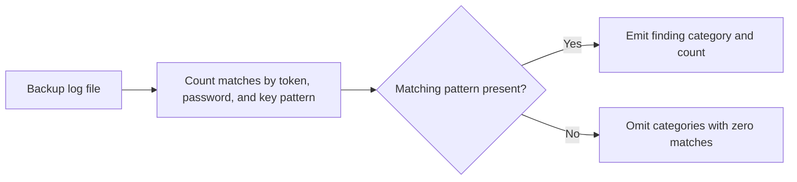

# Backup Secret Exposure Scanner

Backup logs may contain credential-like text. A reviewer needs category counts to decide whether to redact the export before sharing it.

## What I built

I built a defensive log-review CLI that counts supported credential-like patterns by category. The report contains category names and counts so reviewers can decide whether a backup log needs redaction without copying the matching values into a ticket.

## How it works



[Architecture](docs/ARCHITECTURE.md) · [Decision rules and source](docs/RULES.md)

## Tools used

| Tool | Role in this repository |
| --- | --- |
| Python | [secret_scanner.py](secret_scanner.py) implements the CLI and decision rules. Uses `re` to match text patterns. |
| Make | Runs the documented example and the local `unittest` suite. |
| Python replay runner | Compares actual stdout with the checked-in baseline fixtures. |
| Ruff and Bandit | Developer lint and static security checks through `make check`. |

## Run the project

Use Python 3.10+ and Make. From the repository root:

```sh
python3 secret_scanner.py sample_backup.log
```

The synthetic fixture reports one token-like match and one password-like match. [Full expected output](examples/Demo%201.stdout.txt)

## Verify the project

```sh
make verify
make replay
```

`make replay` checks the recorded cases and exits nonzero if the output changes.
See the [developer guide](docs/DEVELOPMENT.md) for the pinned lint and security tools.

## Operating limits

Pattern coverage is limited. The utility neither rewrites logs nor establishes that an export is safe to share.

[Case study](docs/CASE_STUDY.md) · [Operator runbook](docs/RUNBOOK.md) · [Verification report](reports/verification.md)
