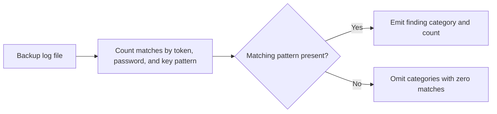

# Backup Secret Exposure Scanner architecture

Scans backup logs for leaked tokens, keys, and connection strings before ticket sharing.

## Operational boundaries

The documented run evaluates the bundled sample locally. Results depend on the quality and scope of the input. The demo makes no live infrastructure changes.
